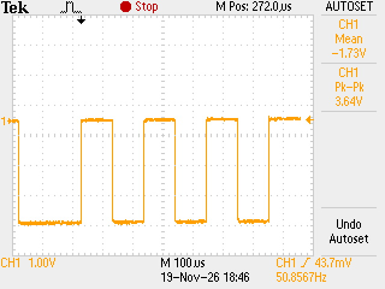
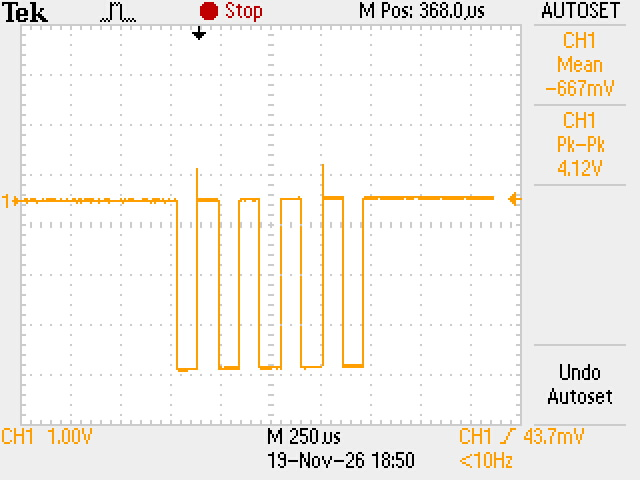
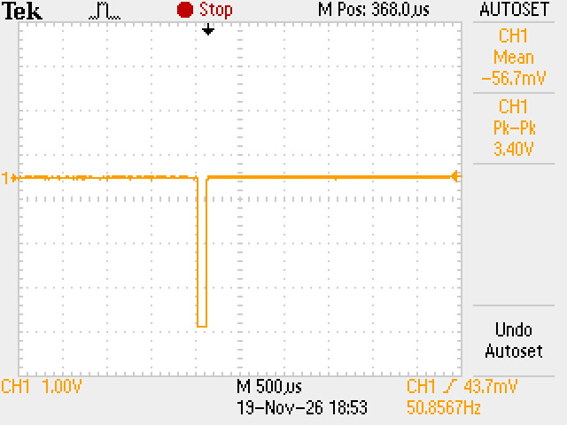
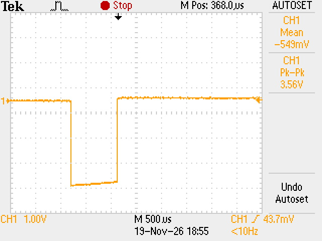

# ECE 528/L - Robotics and Embedded Systems with Lab
**CSU Northridge**

**Department of Electrical and Computer Engineering**

## Bluetooth Low Energy (BLE) Lab
The Bluetooth Low Energy (BLE) lab interfaces with the following:

* User LEDs of the TI MSP432 LaunchPad
* Pololu Gearmotor with Encoder - [Product Link](https://www.pololu.com/product/3675)
* Adafruit Bluefruit LE UART Friend - Bluetooth Low Energy (BLE) Module - [Product Link](https://www.adafruit.com/product/2479)

## Overview
This lab used the UART protocol to send and receive data with the MSP432 LaunchPad. The EUSCI_A3 module was set up in UART mode, and a driver was written for the Adafruit Bluefruit LE UART module. This driver let the LaunchPad talk to a phone over Bluetooth Low Energy (BLE) through the Bluefruit Connect app. First, the driver was used to turn the RGB LED on and off with text commands sent from the phone. Next, an oscilloscope was used to look at the UART signal and check the start bit, data bits, stop bit and bit period. The PMOD SWT switches were also used to pick which byte to send. Finally, the button packets from the app's Control Pad were read and used to drive the robot forward, backward, left and right.
## Components Used
| Components Used | Quantity    | Manufacturer 
| -------------   | ----------- | -----------
| MSP432 Launchpad  | 1 | Texas Instruments
| USB-A to Micro-USB Cable  | 1 | N/A
| TI-RSLK MAX Chassis   | 1 | Pololu
| Adafruit BLE UART Modul  | 1 | Adafruit
| PMOD SWT | 1 | Digilent
| Oscilloscope Probe | 1 | N/A

## Prelab
1. 

## Analysis and Results  
### Tasks A1 and A2  

Figure 1 - Oscilloscope photos for Task A1 and A2 (0xAA, 0x55, 0xFF, 0x00)

### Task B
The BLE_UART_InPacket function receives a 5 byte packet from the BLE module by waiting until the ! header is detected. The header and the next four bytes are then stored in the buffer. The Decode_Controller_Packet function checks for the !B header and reads the button number and state. Buttons 5, 6, 7, and 8 correspond to forward, back, left, and right. When a button is released, the motors stop. When a button is pressed, the corresponding motor function is called.

## Known Issues or Limitations  
There are no known current issues or limitations.  

## Author Contribution  
Anna  
- Wrote Task B

Mario  
- 
  
## References
ECE 528/L Lab 4 - Wireless Control.
